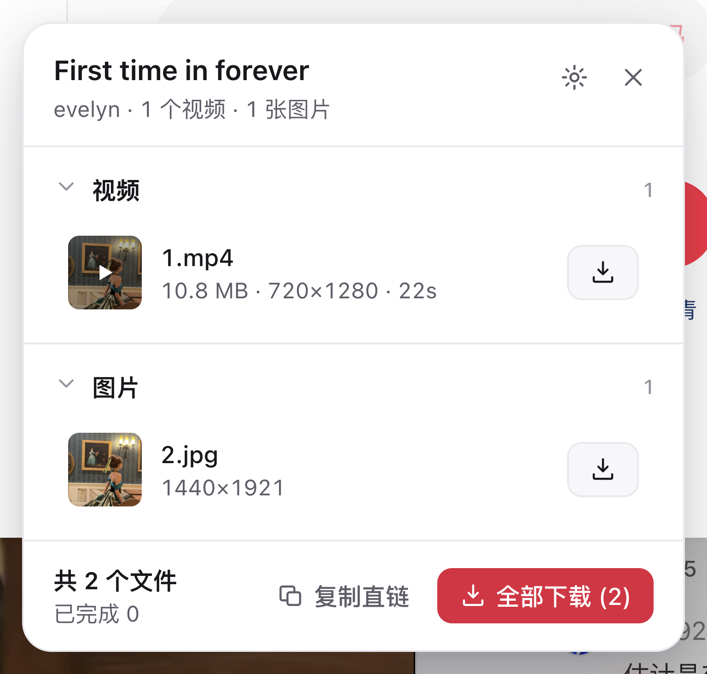

# 小红书下载器（Chrome 扩展）

在小红书网页上一键保存视频与图片：**原始画质、真实进度、批量可选、命名可预期**。



---

## 能做什么

**笔记页**
- 打开任意笔记，右下角出现下载按钮，点击展开面板
- 自动识别该笔记的全部视频与图片，显示尺寸、时长、文件大小
- 每条都能单独下载，也能复制直链
- 顶部可切换「只下载视频 / 只下载图片」，列表和下载按钮跟着变
- 还能切换保存结构：按笔记 / 按作者 / 全部平铺

**用户主页**
- 打开任意用户主页，点一下就扫描这个账号的全部笔记
- 网格展示，按「视频 / 图集」分类，可全选、反选、按需勾选
- 选好后一键批量下载
- 另有「下载内容」筛选：只下视频、或者只下图片（视频笔记的封面算图片，会被跳过）
- 保存结构同样可以在面板里随时切

**下载过程**
- 每一行都有独立的进度条、速度与字节数
- 失败会写明原因（比如「Invalid filename」），可以单独重试
- 网络瞬断会自动退避重试，不会让你干等
- 完成后明确告诉你保存了几个文件

**保存位置与命名**
- 默认落盘：`小红书下载/{作者}/{标题}/1.mp4`、`2.jpg`…
- 三种保存结构可切：按笔记（每篇一个文件夹）/ 按作者（同一作者一个文件夹）/ 全部平铺
- 根文件夹、命名模板、图片格式（JPG / 原图）、并发数都可以在设置页改
- 设置页实时预览完整保存路径，所见即所得
- **走 Chrome 的下载管理器**：文件进你浏览器的「下载」目录，下载栏里看得到
- **文件特别多时可以打包成一个 zip**：几百个文件 → 一个文件，系统只处理一次落盘

### 两种筛选的区别（主页上看着像，作用完全不同）

| 控件 | 位置 | 管什么 |
|---|---|---|
| **笔记类型**（全部 / 视频 / 图集） | 主页批量页工具条第一行 | 决定**看哪些笔记、勾哪些笔记** |
| **下载内容**（全部 / 视频 / 图片） | 工具条第二行（笔记页只有这一行） | 决定**下载哪些文件** |

「下载内容」是全部文件的一个划分：**视频 + 图片 = 全部**。
视频笔记除了 `1.mp4` 还有一个封面 `2.jpg`，封面算图片 ——
所以选「仅视频」时不会连封面一起存，选「仅图片」时封面也在内。
切换后被跳过的数量会写在面板底部（`已跳过 1 张图片`），不做静默丢弃。

### 保存结构：按笔记 / 按作者 / 全部平铺

面板工具条（笔记页第二行 / 主页第三行）随时可切，设置页里也能改。

| 结构 | 落盘结果 | 谁来区分内容 |
|---|---|---|
| **按笔记** | `小红书下载/小美/周末京都/1.mp4` | 目录（作者/标题） |
| **按作者** | `小红书下载/小美/周末京都_1.mp4` | 目录分作者，文件名分笔记 |
| **全部平铺** | `小红书下载/小美_周末京都_1.mp4` | 全靠文件名 |

三种结构用的是**三套命名模板**（设置页里跟着当前结构切换），因为要求不一样：
按笔记时目录里已经有作者和标题，文件名用序号就够；按作者时标题得进文件名；
全部平铺时文件名是唯一的身份标识，必须带作者与标题 ——
不然一堆文件都会叫 `1.mp4`，Chrome 只能给你加成 `1 (1).mp4`。

---

## 安装（开发者模式加载）

```bash
npm install
npm run build
```

然后在 Chrome 里：

1. 打开 `chrome://extensions`
2. 右上角打开「开发者模式」
3. 点「加载已解压的扩展程序」
4. 选择本项目的 `dist/` 目录

> Chrome 137+ 的正式版禁用了 `--load-extension` 命令行参数，所以命令行加载扩展只对
> Chrome for Testing / Chromium 有效（自动化测试用的就是它）。

---

## 使用

1. 打开 <https://www.xiaohongshu.com> 任意一篇笔记
2. 点右下角的下载按钮 → 面板里就是这篇笔记的视频和图片
3. 点「下载」开始，进度会实时显示

> **文件落在哪**：默认走 Chrome 的下载管理器 —— 存进你浏览器的「下载」目录，
> 下完在下载栏里能看到点开。设置页可以切成「打包成 zip」，
> 几百个文件合成一个包，机器只处理一次落盘。

批量下载：

1. 打开某个用户的主页（记得从笔记页点进作者头像，URL 里需要带 `xsec_token`）
2. 点右下角下载按钮 → 自动开始扫描
3. 勾选想下的 → 点「开始下载」

### ⚠️ 批量下载需要登录小红书

小红书在**未登录**状态下不会返回笔记 id（页面里笔记链接只有 `/explore/`，没有具体地址），
所以插件拿不到内容，也就无法下载。

这是小红书的服务端限制，不是插件的问题。登录之后即可完整扫描与下载。
未登录时插件会明确告诉你原因，并给出登录入口。

---

## 设置

点扩展图标 → 右上角齿轮，或右键扩展 →「选项」。

| 选项 | 说明 |
|---|---|
| 文件类型筛选 | 全部 / 仅视频 / 仅图片，面板里也能随时切 |
| 根文件夹 | 相对于浏览器下载目录，默认 `小红书下载` |
| 保存结构 | 按笔记（作者/标题/文件）、按作者（作者/文件）或全部平铺（文件） |
| 命名模板 | 两种结构各一套，支持 `{author}` `{title}` `{index}` `{ext}`，实时预览 |
| 并发下载数 | 1 / 3 / 5 |
| 图片格式 | JPG（兼容性最好）/ 原图（保留原始画质与格式） |
| 扫描主页时自动滚动 | 自动下拉加载更多笔记 |
| 最大扫描轮数 | 每轮约 30 条 |
| 悬停显示下载按钮 | 主页里悬停卡片即可一键下载 |
| 面板主题 | 跟随系统 / 浅色 / 深色 |
| 下载方式 | 浏览器下载（逐个下，默认）/ 打包成 zip（几百个文件合成一个包） |

---

## 开发

用 pnpm（仓库里只保留 `pnpm-lock.yaml` 一份锁文件）：

```bash
pnpm install
pnpm build      # 打包到 dist/
pnpm watch      # 监听改动自动打包
pnpm typecheck  # TypeScript 检查
pnpm test       # 单元测试（93 个用例）
pnpm e2e        # 端到端测试（真实 Chrome：笔记页 1 项 + 主页批量 44 项 + 打包 17 项）
```

> 笔记页那一项只跑得起来 1 条断言：游客态访问真站点的笔记页会被重定向到
> `/login`（错误码 300015 / 300031），其余断言要登录才有意义。
> 主页批量和打包那两套跑的是**假站点**（`scripts/fake-site.mjs`），
> 假站点必须比真站点更「脏」，不然测试全绿、线上照样坏。

> 脚本里不写死包管理器（用的是 `node build.mjs` 而不是 `npm run build`），
> 所以 `npm run build` / `yarn build` 也能跑，只是别再用 npm 装依赖 ——
> 装出来的依赖树和 `pnpm-lock.yaml` 对不上。

### 代码结构

```
src/
  shared/       类型、消息协议、工具函数（文件名清洗、模板渲染）
  content/
    page-hook.ts  MAIN world 代理：读页面状态、拦截 API、路由监听
    bridge.ts     ISOLATED world 侧 RPC 客户端
    detect/       数据提取与检测（raw / media / detector）
    ui/           Shadow DOM 面板、样式、图标、Toast
  background/   下载队列、进度轮询、重试与自愈、设置持久化
    zip.ts        极简 ZIP 写入器（不压缩，STORE）
  offscreen/    后台页面：把几百个文件打成 zip，造 blob 地址
    pack.ts       打包引擎（并行下载 + 串行写入 + 顺序队列）
  popup/        扩展弹窗
  options/      设置页
scripts/
  make-icons.mjs      零依赖生成 PNG 图标
  fake-site.mjs       假站点的「忠实度」工具（按真站点实测的形状写状态）
  e2e.mjs             CDP 端到端测试（笔记页）
  e2e-batch.mjs       CDP 端到端测试（主页批量，跑在本地假站点上）
  e2e-zip.mjs         CDP 端到端测试（打包模式）
  probe-filenames.mjs 实测 Chromium 到底拒绝哪些文件名
  probe-dnr.mjs       实测 DNR 规则对 SW 下载是否生效
  probe-perf.mjs      批量下载性能实测（API 调用量 / 消息量 / 重建次数）
  probe-scale.mjs     规模实测（300 个文件：下载记录数 / 落盘文件数 / 耗时 / iframe 数）
  shot.mjs            给面板截图，改完 UI 用肉眼确认版面
tests/
  core.test.ts        核心逻辑单元测试
  downloader.test.ts  下载队列单元测试（重试 / 空文件 / SW 重启自愈）
  zip.test.ts         ZIP 写入器单元测试（按规范解析字节，交叉验 CRC）
```

### 踩过的坑（写小红书相关代码前先读这几条，都是真实踩过的）

1. **`window.postMessage` 会把消息投递给同一个 window 上的所有监听器，包括发送方自己。**
   MAIN world 与 ISOLATED world 两侧都必须忽略「自己发出的请求」，否则
   - MAIN world 侧会形成「响应 → 当成请求 → 再响应」的**无限消息风暴**
   - ISOLATED world 侧会把自己发出的请求当成响应，**请求被自己 reject**

2. **站点在 `document_start` 之后才写入 `__INITIAL_STATE__`，DOM 也是之后才渲染。**
   content script 跑在 `document_start`，第一次检测必然失败。
   必须重试，并且优先用页面状态（直链最稳），DOM 兜底放最后
   （DOM 里的视频地址常常是 `blob:`，下载不了）。

3. **按 id 取笔记必须精确命中。**
   早期版本「状态里找不到这个 id 就退回任意一条」，结果批量下载时会把**别的笔记**
   当成用户勾选的那条，静默下错内容。拿不到就返回 `null`，让失败可见。

4. **小红书是 SPA，初始化时会 `history.replaceState` 一次。**
   这会触发路由事件，如果处理不当会把面板清空重建成骨架屏 ——
   用户正要点的下载按钮突然消失，那就是一次**静默无响应**（最难查的那种失败）。
   路由处理必须做路径守卫，且重新识别时保留同一篇笔记的旧内容。

5. **文件名只要含一个非法字符，整个 `chrome.downloads.download()` 调用就会失败。**
   不是「文件名被替换」，是**整个下载没发生**。规则见下节。

6. **有一部分笔记的 `title` 字段是空字符串，真正的标题在 `desc` 里。**
   实测（2026-10）推荐流里这种笔记不少。直接读 `title` 会拿到空串，
   再拿笔记编号顶替，用户看到的文件名就变成一串数字 ——
   根因不是「取错了字段」，而是**没有给「标题缺失」准备兜底**。
   现在标题的取值链是 `title → displayTitle → desc 首行 → 列表卡片标题`，
   并且**绝不用编号冒充标题**（编号进了文件名，用户就认不出内容了）。

7. **Service Worker 里没有 `URL.createObjectURL`，也没有 `chrome.downloads`。**
   blob 地址造不出来，下载也发不出去。长时间跑的活儿（比如打包几百个文件）
   更是放不住 —— MV3 的 SW 空闲 30 秒就被杀掉。
   所以要开一个**后台页面（offscreen document）**：它没有存活时间限制，
   也只有 `chrome.runtime` 可用（`chrome.downloads` / `chrome.storage` 都是 `undefined`）——
   于是后台页面造 blob 地址、Service Worker 发下载，两边通过消息接力。

8. **写 ZIP 到文件流必须支持 `seek()`。**
   CRC 和大小要等数据写完才知道，所以先写占位的本地头，写完数据再回头补 ——
   这要求写入器能跳回任意位置。内存版 sink 一开始忽略了 `seek()`，
   结果中央目录的位置全错，包解不开（而且是「看起来下载成功了」的坏包，最难查）。

9. **下载线程和写入线程之间要有个「关队列」的信号。**
   下载是并行的（网络是瓶颈），但 ZIP 是顺序结构，写入必须按勾选顺序串行。
   顺序队列的 `take()` 在「还没有下一个」时会一直等 ——
   下载线程全部结束后必须显式关队列，写入线程才知道可以收工。
   少了这一步，包永远打不完（实测：任务卡在 99%）。

10. **每个任务要用自己的临时目录。**
    打包时开头会清掉目录里的残骸（上次崩了留下的），两个任务同时跑就会互相删文件。
    所以目录名带上任务 id：`pack-<taskId>`。

11. **假站点必须比真站点更「脏」，不然测试全绿、线上照样坏。**
    2026-10-24 踩过：假站点用 `JSON.stringify` 写状态（纯 JSON），
    而真站点的 `__INITIAL_STATE__` 是**带 `undefined` 的 JavaScript 字面量** ——
    于是「抓 HTML」那条快路在测试里永远走通、在真站点上永远走不通；
    假站点的 SSR 里还塞着笔记详情，而真站点是空壳（详情由 XHR 补）。
    两处偏差叠在一起，自动化测试给了 100% 的假信心。
    现在假站点的形状统一写在 `scripts/fake-site.mjs` 里，
    跟真站点的实测行为一一对应。

12. **「解析成功」不等于「拿到东西了」。**
    状态是分批填进来的，早一步返回就是「有 id 没视频」的空壳 ——
    界面上写着成功，实际一个文件都下不出来，还不报错、不重试。
    现在这种情况卡片上写「未取到资源」：既不装作成功（骗人），也不说成「解析失败」
    （那是在怪插件，明明是这条笔记没资源）。这个提示不能被赞数盖住。

13. **「更快的路」不等于「更对的路」。**
    2026-10-25 踩过：v1.3.0 把「抓 HTML」当成主路、快路成了兜底，
    结果下载效果不如 1.0.0。两层原因：
    一是快路在真站点上本来就基本是死的（SSR 里没有笔记详情），
    每条笔记都白抓一个完整页面；二是白抓的请求跟 iframe 抢同一个连接池，
    把 iframe 挤掉 —— 表现就是「解析经常失败」。
    **现在页面渲染说了算，快路必须先自证跟页面那份完全一致才准接手**，
    而且只拿带视频的笔记去自证（视频直链最容易出差别）。
    自动测试里有一条专门盯这个：假站点让 SSR 里的直链指向一个 404 地址，
    扩展必须下页面渲染出来的那条（好的），不能下 SSR 那条。

14. **「等状态里出现空壳」是个等不到的条件。**
    2026-10-25 踩过：向 iframe 要接口响应的条件写成了「状态里已经出现了这条笔记
    （哪怕只是个空壳）」。可站点只肯用接口发详情时，状态里**压根不会有这条笔记** ——
    条件永远不成立，于是唯一拿得到媒体的那条路从来没被走过。
    表现就是「彻底解析不出来，登录也不行」（登录与否不影响，因为卡的是这个条件）。
    现在改成：只要 iframe 里的钩子起来了就问，问不到就隔一会儿再问
    （钩子起来了不等于 XHR 回来了，得给响应落地的时间）。

15. **拿缓存的 HTML 跟页面比，比的是空气。**
    自证要拿「抓到的 HTML」跟「页面渲染出来的那份」逐条比对地址。
    要是这份 HTML 走了浏览器缓存，它可能是一份很久以前的 ——
    直链早就过期、清晰度也不对，于是比对的结果永远是「一致」，
    快路被当成可信的，下到的是一份用户从没见过的文件。
    现在抓 HTML 一律 `cache: 'no-store'`：**自证要比就得比新鲜的**。

16. **跨窗口问话，`event.source` 不是「自己」。**
    钩子（页面世界）监听消息时习惯性写一句 `if (event.source !== window) return;` ——
    同窗消息（隔离世界 ↔ 页面世界）确实是这样。
    但**父页面问隐藏 iframe 时，`event.source` 是父窗口**，这条守卫会把请求整个挡掉，
    钩子从不回话，调用方只能等到超时。
    2026-10-25 踩过：症状是「彻底解析不出来，登录也不行」（跟登录无关，卡的是这个条件）。
    站点只肯用接口发详情时，唯一的路是「问 iframe 里那个钩子要它抓到的接口响应」，
    而这条路被这条守卫整个掐断了。
    排查时用浏览器实测过：**父页面发的消息，子窗口是收得到的**（只是被守卫挡掉）——
    这一点能区分「消息没送到」和「送到了但被拒」。
    现在改成：自己 + 父窗口都认。**通道号才是身份凭证**，跨站页面伪造不出请求。

### 下载方式：浏览器下载 vs 打包成 zip

**默认是 Chrome 的默认下载模式** —— 一个文件一条下载记录，落在浏览器的下载目录里，
下载栏里看得到。（v1.2.0 曾经换成「扩展自己写盘」，那个版本已经删掉了：
它要求用户先选一个文件夹、多一次授权，而且体验反而更差。）

问题在于**文件一多就卡**。实测（`scripts/probe-scale.mjs`，本地假站点，300 个视频）：

| | 浏览器下载 | 打包成 zip |
|---|---|---|
| Chrome 里的下载记录 | **300 条** | **1 条** |
| 磁盘上多了几个文件 | 300 个 | 1 个 |
| 总耗时 | 31.4 秒 | **0.5 秒** |
| 并发提到 10 会更快吗 | 不会（37.7 秒） | — |
| 隐藏 iframe（解析 300 条笔记） | 4 | 4 |

> 这个探针用本地假站点、每个媒体 64KB —— 所以量到的**不是网络带宽，而是「每个文件的固定开销」**。
> 真实视频几十 MB 一个时，两种方式的墙钟时间都会被带宽拉长，
> 但「300 次落盘 vs 1 次落盘」这个结构性差别不变。

**解析阶段有两种形态，差别有多大（同样 300 条笔记）：**

| 解析走哪条路 | 隐藏 iframe | 解析 + 打包下载 | 失败 |
|---|---|---|---|
| 快路自证通过（SSR 里带详情） | 4 个 | **0.5 秒** | 0 |
| 最坏情况（自证不通过，整场走页面） | 300 个（同时最多 4 个） | 40.7 秒 | 0 |

最坏情况对应「SSR 里没有笔记详情」的站点形态（游客态实测如此，登录态还没验证过）——
所以真站点上 300 条笔记可能要等四十秒，**这是正常的**，不是卡死。
（v1.3.0 的「抓 HTML 当主路」在同样场景下是 148 秒：每条笔记都白抓一个页面，
那些请求还跟 iframe 抢连接池。现在白抓的只剩每场一次的自证。）

**打包的价值不是「把文件变小」，是「把 300 个文件变成 1 个」。**
JPEG / MP4 本身就已经压缩过，再 deflate 一遍几乎压不动（通常还更大），
所以包内用的是**不压缩存储**（ZIP method 0）—— 白烧 CPU 还压不动的事不做。
包在 Chrome 的下载栏里仍然是**一条正常的下载记录**，双击就能解开，
不需要任何额外权限，也不用选目录。

**为什么是「整批一个包」而不是「十个一个包」？**
十个一个包只是把 300 变成 30 —— 机器照样要处理 30 次落盘，
而标准 ZIP 单文件上限 4GB，几百个大视频很容易超。真要超了，
扩展会**按 2GB 一个包自动切开**（文件名带 `-1` `-2`），这是兜底，不是默认策略。

**「卡」的另一半根因不在下载，在解析。**
解析一条笔记要开一个隐藏 iframe 加载真实笔记页 —— 300 条笔记就是 300 个 iframe，
机器会明显变卡。所以有一条**快路**（抓笔记页的 HTML，抠出内联的状态），
但它**必须先自证跟页面那份完全一致才准接手**（详见下文「主页里的单篇笔记怎么取」）。
自证通过时 300 条笔记只开 **4 个** iframe（头几条并发的），
自证不通过就整场走页面 —— 慢，但下到的一定是用户看到的那份。

**打包这件事放在哪儿做？**
不是 Service Worker。MV3 的 Service Worker 空闲 30 秒就被浏览器杀掉，
几百个文件的活儿根本跑不完；而且 `URL.createObjectURL` 在 Service Worker 里根本不存在，
blob 地址造不出来。所以放在**后台页面（offscreen document）**里：
它没有存活时间限制，也是一个「像窗口一样」的环境，blob 地址在这儿造，
再交给 Service Worker 去发起下载（后台页面里没有 `chrome.downloads`）。

包先写进扩展的私有文件系统（OPFS），下完就删 —— 几百兆的包不会把内存吃满，
也不会占着用户的磁盘。内存占用 ≈ 并发数 × 单个文件大小（下载并行，写入串行，
因为 ZIP 是顺序结构）。

### 批量下载的性能：查询要合并，渲染要打补丁

「批量下载时卡顿」这个问题，根因不在下载本身，在两个被放大的周边动作。
`scripts/probe-perf.mjs` 在本地假站点上量过（12 条笔记 / 并发 3）：

| 指标 | 改之前 | 改之后 |
|---|---|---|
| `chrome.downloads.search` 次数 | 96（24.8 次/秒） | 12（3.6 次/秒） |
| 往页面推的进度消息 | 26 条 / 58 KB | 9 条 / 11 KB |
| 卡片重建次数 | 300 | 12 |
| 缩略图重建次数 | 300 | 12 |

**一、查询次数原本是「事件数 × 并发数」。**
`downloads.onChanged` 每来一个事件就触发一次全量查询，而全量查询是对
每个在跑的下载各调一次 `search`。事件很密（每个文件至少 filename + state 两条），
并发 3 时一秒能打出去近 50 次 `search` —— 这就是「调用 chrome 下载功能导致卡顿」的真身。

现在：`search` 的 `id` 不接受数组（传数组直接抛 `TypeError`），
所以一次查「最近 N 条」覆盖所有在跑的下载，漏掉的再按 id 补查；
下载事件只负责唤醒定时器，密集事件自然合并成一次查询。

**二、进度每变一次就把整个面板重画一遍。**
主页一次几十张卡片，重画等于 `body.innerHTML = ''` 再重建整张网格，
每个 `` 都要重新解码 —— 这才是页面真正卡住的地方。
（顺带一提：用 MutationObserver 数节点是数不出来的，卡片是在游离节点里
建好才挂上去的，得数「挂上去的那一块里有多少张卡」。）

现在：进度更新只打补丁 —— 笔记页改那一行、主页改那一张卡，缩略图不碰。

### Chromium 的文件名规则（实测，不是猜的）

`scripts/probe-filenames.mjs` 在真实 Chrome 上逐字符扫过，结论：

| 会被拒 | 说明 |
|---|---|
| `: * ? " < > \| \` | 加上控制字符（`\p{Cc}`）与格式字符（`\p{Cf}`，如零宽空格） |
| 以 `.` 开头的路径段 | `.隐藏文件`、`.foo.bar` 都不行 |
| 以 `.` 或空格结尾的路径段 | |
| 保留设备名 | `con` `prn` `aux` `nul` `com1-9` `lpt1-9` `clock$`；判据是**第一个点之前那段**，所以 `con.jpg` 被拒而 `file.con.jpg` 没事 |
| Shell 集成扩展名 | `.url` `.lnk` `.scf` `.local`（判据是**最后一个点**之后的扩展名，所以 `foo.url` 被拒而 `foo.url.jpg` 没事） |
| 空文件名、`.`、`..` | |

> 流传的清单里还有 `.ade` / `.adp`，**实测这两个是可用的**，所以没有拦它们。

插件的清洗分两层：**词干**和**扩展名**分别过规则，截断只切词干 ——
直接截断整串会把 `.jpg` 砍成 `.jp`，用户拿到的文件根本打不开。

### 小红书 CDN 规则（实测结论）

| 类型 | 直链 |
|---|---|
| 图片原图 | `https://sns-img-qc.xhscdn.com/{fileId}`（路径上一段若是 32 位 hex 签名目录则只保留 `fileId`） |
| 图片 JPG | 原图地址 + `?imageView2/format/jpeg` |
| 视频 | `note.video.media.stream` 下遍历所有分桶（名字可能是 `EF4/EF5/…` 也可能是 `h264/h265/…`），取 `backupUrls[0]`（不带签名最稳） |

直接剥掉 URL 末尾的 `!suffix` 会 **403**（签名与后缀绑定）。

当前直链**不校验 Referer**（带与不带都是 200）。

### 下载失败会自己恢复

| 情况 | 行为 |
|---|---|
| 网络瞬断（`NETWORK_FAILED` / `SERVER_FAILED` 等） | 自动退避重试，最多 2 次，界面显示「正在重试」而不是失败 |
| 浏览器说完成但文件是 0 字节 | **判为失败**（否则用户以为下好了，硬盘上却什么都没有） |
| Service Worker 被 Chrome 杀掉（空闲 30 秒） | 重新拉起时用 `downloads.search` 对账：浏览器还认得的继续跟，查无的标失败，不会永远卡在「下载中」 |
| 用户主动取消 | 标为「已取消」，不算失败 |

### DNR 规则为什么删掉了

曾经给 xhscdn 装过一条 `declarativeNetRequest` 规则补 Referer，实测（`scripts/probe-dnr.mjs`）
**它对 Service Worker 发起的下载请求完全无效** —— 同一条规则对页面请求生效，对下载请求不生效。
所以这条规则是死代码，连带 `declarativeNetRequestWithHostAccess` 权限一起删了。

扩展现在只申请 `downloads`、`storage` 和 `offscreen` 三个权限，
`https://*.xhscdn.com/*` 的 host 权限也删了（下载走 `chrome.downloads`，不需要 host 权限）。

### 主页里的单篇笔记怎么取

主页只给卡片，媒体资源要另外取。**主路是隐藏 iframe** —— 也就是 1.0.0 用的那条：

1. **隐藏 iframe（主路）**：开一个隐藏 iframe 加载真实笔记页，读它**渲染后**的
   `__INITIAL_STATE__`。这份状态就是用户眼睛看到的那份：直链是新的、清晰度是那一档。
2. **抓 HTML（快路）**：`fetch` 笔记页的 HTML，从里面抠出服务端渲染好的
   `__INITIAL_STATE__`。快，但**只有自证过跟页面那份完全一致之后才准接手**。
3. **页面自己抓到的接口响应**：笔记详情是页面用 XHR 拉的
   （`/api/sns/web/v1/feed`，实测 2026-10-25 从站点自己的打包文件里核过），
   那个响应里媒体信息最全 —— 直链、清晰度、时长都是原始的。
   钩子同时挂住 `fetch` 和 `XMLHttpRequest`，把响应留在手上。
   **iframe 里的那个钩子抓到的是它自己那条笔记页的响应** ——
   站点只肯用接口发详情（SSR 里没有）时，这是唯一拿得到媒体的地方。
   父页面直接**问 iframe 里那个钩子**要这份响应（跨窗口问话，见坑 16）。
   钩子读 XHR 响应时先读 `responseText`，读不到就用 `response` ——
   站点用 axios（`responseType: 'json'`）时读 `responseText` **会抛**
   （InvalidStateError），只读它的话这条最要紧的路就断了。

**为什么主路是 iframe，而不是快路。**
v1.3.0 把主路换成了抓 HTML，用户反馈「现在的下载效果还不如 1.0.0」。查下来是两件事：

- **快路在真站点上基本是死的**：站点内联的状态不是合法 JSON（是 JavaScript 对象字面量，
  里面带 `undefined`），而且笔记详情**根本不在 SSR 里** —— 详情是页面 JS 跑起来之后
  用 XHR 拉的。于是每条笔记都白抓一个完整页面。
- **白抓的请求会抢连接池**：浏览器每个域名只有 6 条连接，抓 HTML 和 iframe 加载
  走的是同一个站点同一个池子。多打一遍等于把站点压力翻倍，iframe 反而被挤掉 ——
  表现出来就是「解析经常失败」。

**快路要自己证明自己可信才准用。**
第一条带视频的笔记会两条路都跑一遍，把**最终要下载的那个地址**逐条比对
（视频优先用 `backupUrls[0]`，因为那才是实际下下来的那个）：

- 完全一致 → 说明 SSR 里那份和页面渲染那份是同一份东西，之后才允许快路接手
  （几百条笔记就不用开几百个 iframe）。
- 不一致 → 整场都用页面的结果。宁可慢，也不能下到不一样的东西
  （清晰度、地址时效都可能不一样，SSR 里的直链还可能是坏的）。

自证只做一次，整场共享一个结论；抓 HTML 抓不到东西时立刻认输，
后面一条笔记都不再白抓。

**为什么只拿带视频的笔记去自证。**
视频直链是最容易出差别的地方（页面用 backup 地址，SSR 里可能只有 master 地址）。
拿一条纯图片笔记去自证，证明不了视频那条路也靠谱。

抠 `__INITIAL_STATE__` 有两个坑（都是实测踩出来的）：

- **它不是合法 JSON。** 站点的状态是 JavaScript 对象字面量，里面有 `undefined`
  （实测 2026-10-24：登录页 23 处、发现页 29 处）。直接 `JSON.parse` **必然抛错** ——
  早先的快路就是这么写的，于是它在真站点上 100% 失效、每次都白抓一个页面。
  现在按括号配平扫描出对象文本，再把 `undefined` / `NaN` / `Infinity` 这些
  JSON 里没有的字面量换成 `null` 之后才解析。
- **笔记详情可能不在 SSR 里。** 游客态下笔记页 SSR 出来的 `note.noteDetailMap` 是空的 ——
  详情是页面 JS 跑起来之后用 XHR 拉的。这种站点上快路是白费的，
  现在会**认出来**（状态里连详情块都没有）并立刻改走 iframe。

时间预算也是算过的：抓 HTML 最多 5s（请求卡住时自己掐表），
隐藏 iframe 最多 8s（笔记已经出现但媒体还没补上时，再多等 2.5s），
向 iframe 要接口响应最多问 6 次（每次间隔 0.7s），
整条链路 20s 封顶。桥接层给这个调用单独放宽到 26s —— 之前用默认的 15s，
会在预算用完之前先把调用砍掉，界面上就显示成「解析失败」。

不走站点 API 是有原因的：页面的 `window._webmsxyw` 只能生成 `X-s`/`X-t` 两个签名头，
直接调 `/api/sns/web/v1/feed` 会返回 `500`；真正可用还需要 `mnsv2`、`a1`、`X-S-Common`
一整套反爬头，站点改一次签名逻辑就得重做一遍。

**「解析出来了，但一个资源都没拿到」不算失败，也不装作没事。**
页面的状态是一点点填进来的：一开始只有 id 和标题，视频直链是后面才补上的。
早一步返回就会拿到一个空壳 —— 界面上是「解析成功」，但一个文件都下不出来，
还不报错、不重试。现在这种情况卡片上写「**未取到资源**」：
既不说成成功（那是骗人），也不说成「解析失败」（那是在怪插件，明明是这条笔记没资源）。
这个提示不会被赞数盖住。

---

## 已知限制

- **主页批量下载需要登录**（见上文）
- **笔记页的真实形状只能在登录态下验证**：2026-10-24 起，小红书对**未登录**的
  笔记页 / 主页访问一律重定向到 `/login`（错误码 300015 / 300031），
  所以自动化测试跑在本地假站点上，真实站点只在游客态做过结构核对 ——
  登录态下的「笔记页 SSR 里到底有没有详情」还需要人工确认一次。
- **不支持 rednote.com（国际版）**：该站所有页面强制跳登录，游客态无法验证笔记结构
- 直链有效期约 2 小时，过期后重新识别即可
- 只支持小红书网页端
- 视频笔记的封面会作为一个图片项一并提供（按「仅视频」筛选时会被跳过）
- **打包模式要多等一会儿**：文件要先收齐再打成包，界面上的进度条走的是「打包进度」，
  不是「下载进度」——包没打好之前，磁盘上还没有东西
- **打包模式下的单文件重试**会单独打一个 `-补` 的小包，不影响已经下好的那个包
- 极少数笔记既没有标题也没有可用的正文首行（极少），文件名里只会剩序号 ——
  面板上会显示「未命名笔记」，不会拿编号冒充标题
- **频繁下载原始画质可能触发平台限流**：竞品 RedNote Downloader 明确提示，大量下载原画
  可能导致账号被要求重新登录并进入 1–3 天冷却期（压缩画质与其它媒体不受影响）。本产品默认下载原画。

---

## 致谢与边界

本工具只下载你在小红书网页上**主动查看**的内容，用于个人收藏与备份。
请尊重内容作者的版权，不要用于二次分发或商业用途。

详细设计文档见 [`docs/superpowers/specs/2026-10-24-xhs-downloader-design.md`](docs/superpowers/specs/2026-10-24-xhs-downloader-design.md)。
